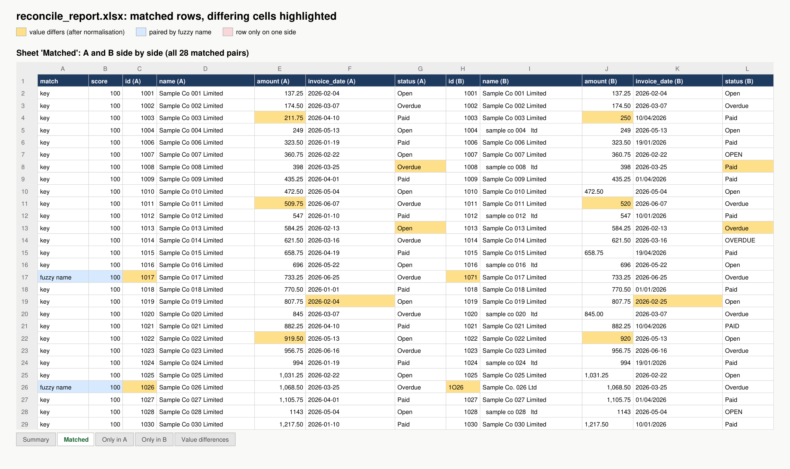
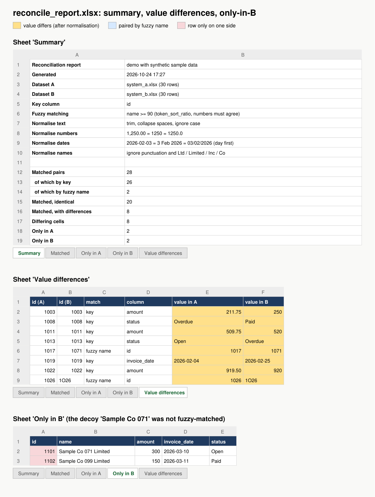

# Excel Data Reconcile Demo

> **This is a demo.** All data is synthetic and generated by `make_samples.py`. Company names are
> obviously fake ("Sample Co 001 Limited"). No real people, clients or figures are involved.

Compares two datasets (two CSVs, two workbooks, or two sheets of one workbook) by a key column. It
normalises the values first so that formatting noise is not reported as a difference, can pair rows
whose key was mistyped by fuzzy-matching a name column, and writes an Excel report.




The images are rendered from `samples/reconcile_report.xlsx` by `tools/make_screenshots.py`, which
reads the workbook's values, fills and fonts with openpyxl.

## Run
```bash
pip install -r requirements.txt
python make_samples.py                     # writes samples/system_a|b.xlsx, .csv, two_sheets.xlsx
python reconcile.py samples/system_a.xlsx samples/system_b.xlsx --key id --fuzzy name:90 -o report.xlsx
python reconcile.py samples/system_a.csv  samples/system_b.csv  --key id
python reconcile.py "samples/two_sheets.xlsx#System A" "samples/two_sheets.xlsx#System B" --key id --fuzzy name:90
python -m pytest -v
```
Options: `--fuzzy COLUMN:THRESHOLD` (0-100), `--monthfirst` (read `03/02/2026` as 2 March), `-o` output path.

Console output for the sample data:
```
key only:      matched 26 (fuzzy 0), only in A 4, only in B 4, differing cells 6 in 6 rows
--fuzzy name:90: matched 28 (fuzzy 2), only in A 2, only in B 2, differing cells 8 in 8 rows
```

## The report (`samples/reconcile_report.xlsx`)
| Sheet | Contents |
|---|---|
| Summary | inputs, key, fuzzy setting, normalisation rules, counts, duplicate keys if any |
| Matched | A and B side by side; differing cells in amber, fuzzy-paired rows marked blue with their score |
| Only in A / Only in B | rows with no partner |
| Value differences | one row per differing cell: keys, how it matched, column, value in A, value in B |

## What the sample data contains (planted on purpose)
- **Noise that must not count**: extra spaces, upper/lower case, `Limited` vs `ltd`, amounts as text
  `"1,250.00"`, dates as `dd/mm/yyyy` text, `"OPEN "` vs `Open`.
- **Real differences**: 3 amounts, 2 statuses, 1 date.
- **Missing rows**: 2 only in A, 2 only in B.
- **Mistyped keys**: `1017` became `1071`, and `1026` became `1O26` (letter O). With `--fuzzy name:90` both
  are paired by name and the key difference itself is reported.
- **A decoy**: `Sample Co 071 Limited` exists only in B. It is textually close to `Sample Co 017` but
  must not be matched. It is not, even at a threshold of 50.

## Design notes
- **Normalise, then compare.** Each cell is compared as a number if it parses as one, else as a date,
  else as trimmed, case-folded text. Name columns also drop punctuation and trailing company suffixes.
  The raw values are kept in the report so a reviewer sees what was actually in each file.
- **Key first, fuzzy second.** Fuzzy matching only runs on rows the exact key could not pair, so it
  cannot override a correct key match.
- **Fuzzy is one-to-one and best-first.** All candidate pairs above the threshold are scored
  (rapidfuzz `token_sort_ratio`) and taken from the highest score down, with each row used once.
- **Numbers in names must agree.** `Sample Co 017` and `Sample Co 071` score high as text, but they are
  different entities. Requiring the digit groups to be equal stops this common false match.
- **Duplicate keys are reported** on the Summary sheet, not silently merged. The first occurrence is matched.
- **Ambiguous dates are explicit.** `03/02/2026` is read day-first by default. `--monthfirst` switches it,
  and the Summary sheet states which rule was used.

## Limits (honest)
- Name fuzzy matching is for typos and formatting. It does not know that two different trading names
  belong to one company.
- Very large files (millions of rows) need a blocking step before fuzzy matching. This demo compares
  the unmatched rows pairwise.
- Tolerances such as "amounts within 0.01" are not configurable yet. Numbers are compared after
  rounding to 6 decimals.

## Test results (real run, Python 3.13, pandas 2.2.3, openpyxl 3.1.5, rapidfuzz 3.14.1, Windows 10)
```
32 passed
```
Covered: text, name, number, date and key normalisation (including day/month order), the
numbers-must-agree guard, key-only matching, fuzzy pairing of the two mistyped keys, the decoy staying
unmatched, the threshold boundary, one-to-one fuzzy, duplicate keys, a missing key column, exactly the 8
planted differences found, cosmetic noise not reported, identical results from xlsx, csv and two-sheet
input, the report sheets, counts and highlight colours, and CLI argument validation.

## Licence and contact
MIT, © 2026 SheldonTek Co., Limited. https://sheldontek.com
